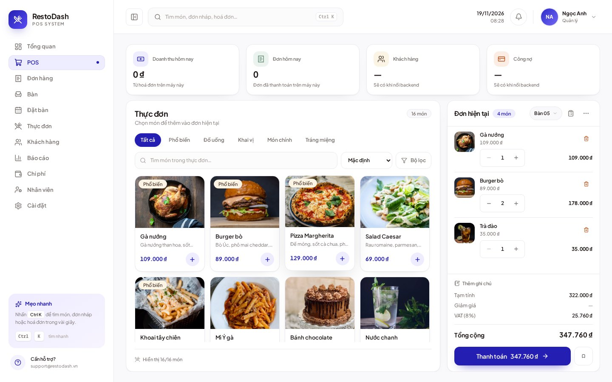

# RestoDash POS

Frontend POS cho nhà hàng/quán ăn: gọi món, giỏ hàng, giảm giá, thanh toán và in hoá đơn 80mm. Giao diện tiếng Việt, tiền tệ VND, tối ưu cho laptop tại quầy và tablet. Ứng dụng chạy hoàn toàn trên trình duyệt, lưu đơn nháp và lịch sử trên chính thiết bị, dùng được khi mất mạng sau lần tải đầu.

> Backend, đăng nhập và đồng bộ nhiều máy đã có từ Phase 1. Hiện tại POS, Đơn hàng, Thực đơn và **Bàn** là các màn hình dùng thật, với popup đơn dùng chung và đơn chờ thanh toán lưu local; các mục còn lại là placeholder có chủ đích.

> **Tài liệu gốc cho mọi fork:** [PROJECT.md](PROJECT.md) — báo cáo dự án, kiến trúc, quyết định đã chốt, lộ trình Bàn/Đặt bàn/Nhân viên và quy trình lập kế hoạch. Đọc file này trước khi phát triển module mới.

> **Backend (Phase 1):** API NestJS + PostgreSQL chạy local, sẵn sàng cho Phase 2 nối frontend — xem [`server/README.md`](server/README.md).



## Tính năng

- **Gọi món**: 16 món mẫu, tabs danh mục, tìm kiếm không dấu, lọc món phổ biến, sắp xếp theo giá, tải thêm món.
- **Đơn hiện tại**: panel phải chỉ quản lý món — chọn bàn hoặc mang đi, tăng/giảm số lượng (món đã mang ra bị khoá), tổng tiền VAT 8% và nút **Tạo đơn**. Ghi chú/giảm giá/thanh toán được làm trong popup.
- **Bàn** (`#/tables`): sơ đồ bàn nhóm theo khu vực với 3 trạng thái suy ra từ đơn mở — `Trống` / `Chưa phục vụ` / `Đã phục vụ` (luôn có nhãn chữ + icon). Bấm bàn để mở đơn; đổi bàn tự cất/nạp đơn nên không mất món. Tick “Đã mang ra” theo từng món hoặc “Chọn tất cả”; món đã ra bị khoá sửa/xoá, muốn đổi thì thêm món mới. Thanh toán xong bàn về trống ngay (nếu còn món chưa ra, app hỏi xác nhận thêm một lần). Thêm/xoá bàn chạy cả khi mất mạng, đồng bộ server khi có mạng lại; xoá mềm, chỉ Owner/Manager được thêm/xoá, và không xoá được bàn đang có đơn mở.
- **Popup đơn dùng chung**: `OrderModal` mở từ POS (nút **Tạo đơn**), từ bàn đang có đơn trên trang Bàn, và từ đơn chờ trên trang Đơn hàng. Chọn bàn/Mang đi, chỉnh món, ghi chú, giảm giá rồi **Lưu chờ thanh toán**, **Thanh toán**, **Thêm món** hoặc **Huỷ đơn**. Cảnh báo 2 bước vẫn áp dụng khi còn món chưa mang ra.
- **Thanh toán**: tiền mặt (tính tiền thối, chặn thu thiếu), chuyển khoản, thẻ. Đơn hoàn tất được lưu vào lịch sử trên thiết bị. Đơn mở của từng bàn chỉ lưu local; server chỉ nhận đơn đã thanh toán.
- **Đơn chờ thanh toán**: là **đơn thật** lưu trên thiết bị (`Chờ thanh toán`), **không phải đơn nháp** và không gửi lên server. Bàn vẫn bận tới khi thu tiền hoặc huỷ. “Thêm món” nạp đơn lại vào giỏ POS mà không mất món đang soạn; lưu lại cập nhật chính đơn đó (không tạo bản trùng). Trang Đơn hàng hiện 3 trạng thái kèm màu + chữ: **Chờ thanh toán** (vàng), **Đã huỷ** (đỏ), **Thành công** (xanh lá).
- **Hoá đơn**: bản in 80mm qua hộp thoại in của trình duyệt; xem và in lại từ trang Đơn hàng hoặc tìm kiếm toàn cục.
- **Đơn nháp**: mở lại, xoá, cảnh báo trước khi thay thế đơn đang làm.
- **Tìm kiếm toàn cục**: `Ctrl/⌘ K` tìm món, đơn nháp, hoá đơn; điều hướng bằng bàn phím.
- **PWA**: cài như ứng dụng, precache tài nguyên, tự cập nhật khi có bản mới.
- **Responsive**: sidebar đầy đủ trên desktop, thu gọn ở 1024–1279px, drawer dưới 1024px; giỏ hàng là drawer + thanh tổng tiền cố định trên màn hình nhỏ.

## Chạy dự án

Yêu cầu Node.js `^20.19.0` hoặc `>=22.12.0` (điều kiện của Vite 8).

```bash
npm install
npm run dev
```

Mở `http://localhost:5173/#/pos`. App dùng hash router, mỗi trang có URL riêng: `#/pos`, `#/orders`, `#/menu`, `#/tables`, … Để thử trên tablet trong cùng mạng LAN:

```bash
npm run dev -- --host
```

### Build và kiểm thử

```bash
npm test        # Vitest + Testing Library
npm run lint    # oxlint
npm run build   # type-check + build tĩnh vào dist/
npm run preview # chạy thử bản build
```

Deploy bằng cách phục vụ thư mục `dist/` trên hosting tĩnh bất kỳ. PWA cần `https://` hoặc `localhost`; service worker không chạy ở chế độ dev.

## Cấu hình

| Nội dung | Tệp |
| --- | --- |
| Tên quán, địa chỉ, điện thoại, email, thuế VAT, tên thu ngân | `src/config.ts` |
| Món, giá, danh mục, ảnh, nhãn phổ biến | `src/data/menu.ts` |
| Bàn và số chỗ | Server seed `server/prisma/seed-data.ts`; fallback offline `src/data/catalog-seed.ts` — thêm/xoá bàn từ `#/tables` |
| Ảnh món (WebP, khung 4:3) | `src/assets/menu/` |
| Màu sắc, font, hiệu ứng, CSS in | `src/index.css` |
| Manifest, icon, precache | `vite.config.ts`, `public/` |

Menu mặc định dùng `id` ổn định. Khi thêm món, giữ `id` duy nhất; đơn nháp và hoá đơn cũ tham chiếu món theo `id`, nên không nên đổi `id` của món đã bán. Giá món được đọc tại thời điểm tính tiền; hoá đơn đã lưu giữ giá tại lúc thanh toán.

Thuế mặc định `taxRate: 0.08` (8%) và được tính trên tạm tính sau giảm giá. Sửa trong `src/config.ts` nếu quán dùng mức khác.

## Dữ liệu lưu trên thiết bị

Store dùng Zustand persist với key:

```text
restodash-pos-v1
```

Bao gồm: giỏ hàng đang làm, bàn đang chọn, giảm giá, ghi chú, danh sách đơn nháp, hàng đợi đơn chờ đồng bộ, lịch sử đơn (đã thanh toán/chờ thanh toán/đã huỷ), `openOrders` (giỏ treo theo bàn) và `editingPendingOrderId` (đơn chờ đang soạn). Dữ liệu tồn tại qua reload và tắt/mở trình duyệt.

**Persist version 4** (từ 22/11/2026): key giữ nguyên `restodash-pos-v1` để migrate tại chỗ. Dữ liệu cũ tự động nâng cấp (v1/v2 → v3 → v4), giữ nguyên giỏ/nháp/lịch sử/hàng đợi: v3 thêm `openOrders` và cờ `served` trên từng món; v4 thêm trạng thái đơn (`pending_payment`/`completed`/`cancelled`) và `editingPendingOrderId` (đơn chờ đang soạn). Dòng cũ thiếu `served` được hiểu là chưa mang ra. Đơn mở và đơn chờ chỉ nằm trên thiết bị này — **server không đổi**, chỉ nhận đơn đã thanh toán. Xoá key dưới đây sẽ mất cả đơn mở/đơn chờ đang treo.

- **Xoá dữ liệu**: DevTools → Application → Local Storage → xoá key trên, hoặc chạy `localStorage.removeItem('restodash-pos-v1')` trong Console.
- **Sao lưu**: copy giá trị JSON của key để cất; khôi phục bằng `localStorage.setItem('restodash-pos-v1', '<json>')` rồi tải lại trang.
- **Một thiết bị, một tab**: chưa có đồng bộ giữa các tab/máy. Không nên mở nhiều tab POS cùng lúc vì thao tác ở tab sau có thể ghi đè dữ liệu của tab trước.

Dữ liệu nằm trong trình duyệt của máy đang dùng. Xoá dữ liệu trình duyệt, đổi profile hoặc dùng chế độ ẩn danh sẽ làm mất đơn nháp/lịch sử.

## In hoá đơn

1. Thanh toán xong, bấm **Xem hoá đơn** → **In hoá đơn**; hoặc vào **Đơn hàng** và chọn **Xem hoá đơn**.
2. Trong hộp thoại in, chọn máy in 80mm, khổ giấy 80mm, lề khoảng 4mm, tỉ lệ 100%.
3. Tắt headers/footers của trình duyệt. Có thể bật "Background graphics" nếu muốn giữ nền trắng/xám của bản in.
4. Chỉ nội dung `.print-area` được in; giao diện POS xung quanh bị ẩn bằng CSS.

Hiện tại app dùng hộp thoại in của trình duyệt, chưa gửi lệnh trực tiếp tới máy in ESC/POS. Chuyển khoản/thẻ mới ghi nhận phương thức thanh toán, chưa xác nhận giao dịch với ngân hàng.

## PWA và chế độ offline

```bash
npm run build
npm run preview
```

Mở bản preview bằng `localhost` (hoặc deploy HTTPS), sau đó dùng nút cài đặt trên thanh địa chỉ (Chrome/Edge) để cài RestoDash. Service worker precache HTML, JS, CSS, font, icon và ảnh món; sau lần tải đầu, app mở được khi mất mạng. Khi deploy bản mới, `autoUpdate` sẽ kích hoạt cập nhật và có thể cần tải lại trang một lần.

Dữ liệu bán hàng không phụ thuộc mạng. Tuy nhiên, lần đầu cài đặt và mọi bản cập nhật đều cần mạng.

## Ảnh món

Ảnh trong `src/assets/menu/` là ảnh stock miễn phí dùng cho menu mẫu, **không phải ảnh món thật của quán**. Nguồn và giấy phép ghi tại [`src/assets/menu/CREDITS.md`](src/assets/menu/CREDITS.md) (Unsplash License và Pexels License).

Khi dùng thật, thay từng tệp cùng tên bằng ảnh chụp món của quán: khung 4:3, nén WebP dưới khoảng 150KB để giữ thời gian tải nhanh.

## Cấu trúc chính

```text
src/
  app/router.tsx      hash router, route table, layout + layout context
  assets/menu/        ảnh món + CREDITS.md
  components/         layout, menu, order (OrderPanel + OrderModal dùng chung), modals, receipt, search, stats, ui, tables
    ErrorBoundary.tsx chặn lỗi render, trang lỗi tiếng Việt
  data/               menu.ts, tables.ts, catalog-seed.ts
  lib/                calc, format, search, id, menu-query, global-search, table-state
  pages/              POSPage, OrdersPage, TablesPage, MenuPage, PlaceholderPage
  store/              usePOSStore.ts, useCatalogStore.ts
  sync/               worker.ts (đơn), table-sync.ts (bàn)
  config.ts           thông tin quán, tài khoản hiển thị, danh sách trang
  index.css           theme, animation, print CSS
docs/
  superpowers/        spec và plan triển khai
  screenshots/        ảnh giao diện
public/               favicon và icon PWA
```

## Giới hạn đã biết

- Đã có backend và đăng nhập PIN theo thiết bị; chưa có đồng bộ nhiều thiết bị theo thời gian thực hay sao lưu tự động. Đơn mở và đơn chờ thanh toán chỉ lưu local; server chỉ nhận đơn đã thu tiền.
- Khách hàng và Công nợ hiển thị “—” cho tới khi nối backend; app không tạo số liệu giả.
- Chưa tích hợp máy in ESC/POS, QR ngân hàng hay máy quẹt thẻ.
- Các trang Tổng quan, Đặt bàn, Khách hàng, Báo cáo, Chi phí, Nhân viên, Cài đặt là placeholder; trang Bàn đã dùng thật.
- Gộp/chuyển/tách bàn, đặt bàn trước và cập nhật trạng thái bàn realtime giữa nhiều máy chưa có (xem `PROJECT.md` §8.4).
- PWA cần HTTPS hoặc localhost. Safari/iPad có thể có khác biệt nhỏ về hộp thoại in và cách cài đặt.
- Chưa hỗ trợ nhiều tab/thiết bị cùng lúc; dữ liệu chỉ nằm trên trình duyệt hiện tại.
- Ảnh món là ảnh minh hoạ stock, cần thay bằng ảnh thật của quán.

## Kiểm thử

Bộ test hiện có 316 test (39 file) cho logic tính tiền, store/persist v4, bàn (3 trạng thái, served, đơn mở, CRUD/xoá mềm), đơn chờ (không trùng bản ghi, giữ giỏ khi resume, cash fields đúng), popup dùng chung, 3 trạng thái đơn, tìm kiếm, routing, các luồng giỏ hàng/thanh toán/đơn nháp và các component chính. Server có thêm 64 unit test và 108 e2e test (`cd server && npm test && npm run test:e2e`; e2e cần Postgres + `TEST_DATABASE_URL`). Server không đổi trong module popup. Test chạy trên jsdom với viewport 1440×900; kiểm tra giao diện thật được thực hiện thêm bằng trình duyệt ở các kích thước 1440×900, 1280×800, 1024×768 và 390×844. Ảnh tham chiếu: [desktop](docs/screenshots/pos-desktop.jpg), [1024×768](docs/screenshots/pos-1024.jpg), [mobile](docs/screenshots/pos-mobile.jpg).

Thiết kế tham chiếu: [Restaurant POS Dashboard UI Design](https://dribbble.com/shots/27321876-Restaurant-POS-Dashboard-UI-Design) của Rexnor studio. Font Plus Jakarta Sans, icon Lucide.
